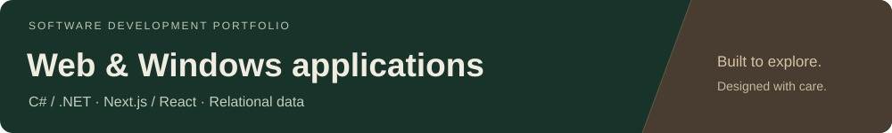
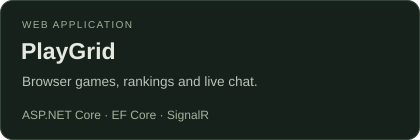
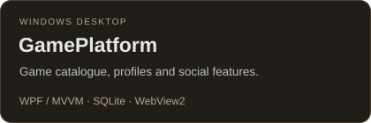
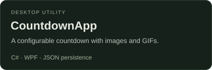
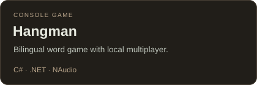
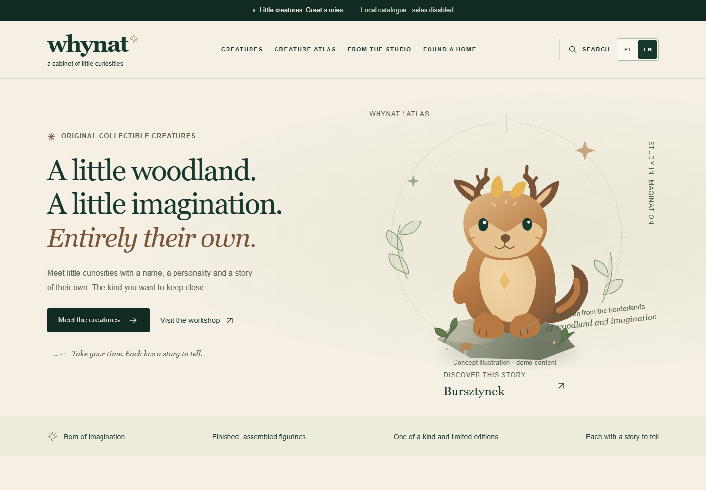

I build **web and Windows desktop applications**, with a focus on **C# and .NET**. My projects explore application architecture, relational data, real-time features and thoughtful interfaces.

## Technical focus

- **Backend & data:** ASP.NET Core, MVC, REST APIs, Identity, Entity Framework Core, SQL Server and SQLite.
- **Desktop:** WPF, MVVM, WebView2 and local settings persistence.
- **Web interfaces:** Next.js, React and TypeScript.
- **Testing & delivery:** xUnit, Playwright, Git and GitHub Actions.

## Selected .NET projects

Start with **[PlayGrid](https://github.com/rafalowskaa/BrowserGamesPlatform)** for backend architecture, or **[GamePlatform](https://github.com/rafalowskaa/GamePlatform)** for a desktop project.

[Architecture notes](https://github.com/rafalowskaa/BrowserGamesPlatform/blob/main/docs/ARCHITECTURE.md) · [Build & test workflow](https://github.com/rafalowskaa/BrowserGamesPlatform/actions/workflows/dotnet.yml)

## Website preview

### WHYNAT · a cabinet of little curiosities

A bilingual catalogue for collectible figurines, combining an editorial storefront with a dedicated content-management panel. Each creature has its own story, image gallery, specifications and edition details.

  

**Highlights:** responsive desktop and mobile layouts, Polish/English content, catalogue search and filters, and product storytelling.

**Built with:** Next.js · React · TypeScript · Medusa · PostgreSQL · Playwright.

Homepage preview from a local demonstration build. Concept artwork and demo content; sales and payments are disabled.
